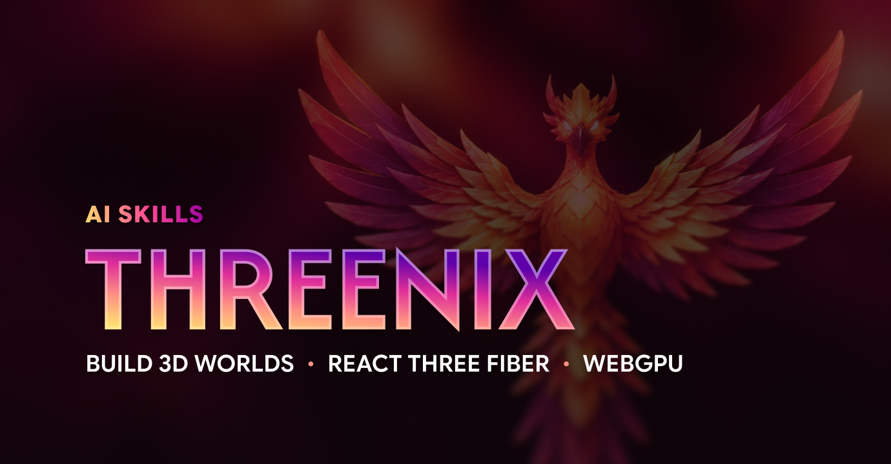

[](https://threenix.io)

[Explore the demo](https://threenix.io)

# Skills for Advanced React Three Fiber + WebGPU Developers

[](https://skills.sh/prag-matt-ic/threenix-plugin)

Build WebGPU scenes and improve existing Three.js code with focused AI skills from Threenix, a Three.js development studio. The skills cover R3F v10 scene components, GPU particle effects, performance reviews and TSL shaders.

_Currently in Alpha._

## Why Threenix

React Three Fiber v10 and Three.js Shading Language (TSL) are still evolving. Reliable patterns can be hard to find online, and performance best practices are easy to miss. These skills bring together scene components, shader patterns and review workflows developed alongside real 3D projects.

## Installation

### Skills CLI

Run this from your project directory to install Threenix skills:

```bash
npx skills add prag-matt-ic/threenix-plugin
```

Follow the prompts to choose your skills and agents. For Cursor-specific guidance, see Cursor's [Skills guide](https://cursor.com/help/customization/skills).

<details>
<summary><strong>ChatGPT / Codex</strong></summary>

```bash
codex plugin marketplace add prag-matt-ic/threenix-plugin
codex plugin add threenix@threenix
```

</details>

<details>
<summary><strong>Claude Code</strong></summary>

```bash
claude plugin marketplace add prag-matt-ic/threenix-plugin
claude plugin install threenix@threenix
```

</details>

## Start here

- **Review an existing scene:** [`threenix-best-practices`](skills/threenix-best-practices/SKILL.md)
- **Start a WebGPU scene:** `$threenix-add-component webgpu-canvas`
- **Use R3F v10 hooks:** [`threenix-r3f-v10-webgpu-hooks`](skills/threenix-r3f-v10-webgpu-hooks/SKILL.md)
- **Add a visual effect:** `$threenix-add-component fireworks`

## Skills

Start a new task or session after installing. For focused reviews, `@`-mention the chosen files as context.

Invoke a skill by name: `$threenix-best-practices` in Codex, `/threenix-best-practices` in Cursor or Claude Code when installed through the Skills CLI, or `/threenix:threenix-best-practices` with the Claude Code plugin.

The plugin provides six skills: one for adding components, plus focused review, benchmark, optimization, and WebGPU hooks workflows.

### Review / Refactor

Catch performance problems, remove unnecessary complexity, and make Three.js, R3F, and TSL code easier to maintain.

| Skill                                                                            | What it does                                                                                 |
| -------------------------------------------------------------------------------- | -------------------------------------------------------------------------------------------- |
| [`threenix-best-practices`](skills/threenix-best-practices/SKILL.md)             | Review and refactor Three.js and R3F code for performance and clarity.                       |
| [`threenix-benchmark-webgpu`](skills/threenix-benchmark-webgpu/SKILL.md)         | Measure Three.js WebGPU render and compute workloads with GPU timestamps.                    |
| [`threenix-clean-code`](skills/threenix-clean-code/SKILL.md)                     | Review and refactor TypeScript code against a Clean Code checklist.                          |
| [`threenix-optimize-tsl`](skills/threenix-optimize-tsl/SKILL.md)                 | Optimize Three.js Shading Language (TSL) nodes without changing their visible output.        |
| [`threenix-r3f-v10-webgpu-hooks`](skills/threenix-r3f-v10-webgpu-hooks/SKILL.md) | Choose WebGPU hooks and manage uniforms, graphs, buffers, textures, and pipeline lifecycles. |

For standalone baselines or before/after GPU comparisons, use [`threenix-benchmark-webgpu`](skills/threenix-benchmark-webgpu/SKILL.md) and its [Node benchmark guide](skills/threenix-benchmark-webgpu/BENCHMARK.md). `threenix-optimize-tsl` uses it when a shader change needs measurement.

### Add Components

[`threenix-add-component`](skills/threenix-add-component/SKILL.md) discovers the live library through `list_components`, then fetches only the selected `get_component_reference`. It supports components, hooks, Canvas setup, backgrounds, and scene warmup without bundling their source or a fixed catalogue.

| Editor              | Example                                      |
| ------------------- | -------------------------------------------- |
| Codex               | `$threenix-add-component fireworks`          |
| Claude Code plugin  | `/threenix:threenix-add-component fireworks` |
| Cursor / Skills CLI | `/threenix-add-component fireworks`          |

The skill requires the public Threenix MCP endpoint at `https://developers.threenix.io/mcp`; no API key is needed. Marketplace installs include its configuration. Skills CLI users must also connect that MCP server in their agent. If the connection fails, installation stops with an explanation.

Canonical source, dependencies, and integration notes come from MCP. Large asset collections download directly to disk, preserving relative paths without placing binary data in model context. Existing renderers and dependency ranges are preserved; WebGL migration is a separate task.

## Startup updates

Codex and Claude Code marketplace installs (v0.8.0+) check for updates when you start or resume a session and can update the plugin and its skills automatically. This requires Node 20+, Git and the relevant CLI, plus hook approval in Codex. Existing users need one manual plugin update to enable it. Start a new session to load updated skills. Failed checks let work continue. Skills CLI installs and pinned or local copies aren’t updated automatically.
